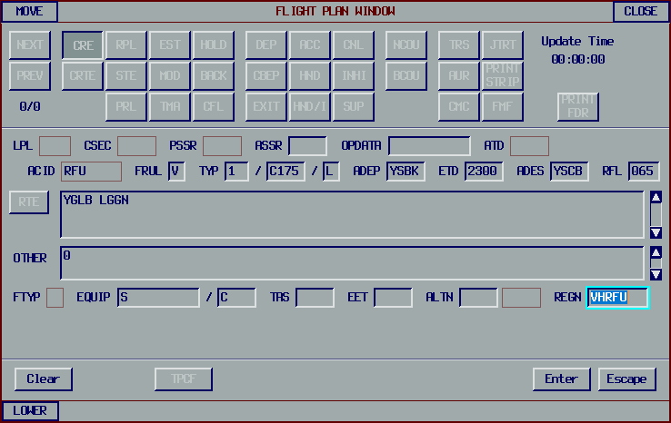

# Eurocat FP Window (vatSys plugin)

Replaces the stock vatSys Flight Plan Window with one laid out like the Eurocat (TAAATS) FPL window.



## Build

```powershell
dotnet build -c Release
```

Needs the .NET SDK and a vatSys install. If vatSys is not in `C:\Program Files (x86)\vatSys`, pass
`-p:VatSysDir="<path>\bin"`.

## Install

Copy `bin\Release\EurocatFPWindow.dll` and `bin\Release\0Harmony.dll` into a folder under the profile's
`Plugins` directory, e.g. `Documents\vatSys Files\Profiles\Australia\Plugins\EurocatFPWindow\`, then restart
vatSys. Remove the folder to go back to the stock window.

## How it works

vatSys has no hook for replacing the window, so the plugin patches `MMI.OpenFPWindow` with Harmony
(`Patches.cs`). A second patch on the stock window's Load handler catches any stock window that still
opens and swaps it. If anything fails, the stock window opens and the error is listed in vatSys.

Non-public vatSys members are reached by reflection in `Internals.cs`; a vatSys update that renames them
breaks that one feature rather than the whole window.

## Button mapping

| Button | Action |
| --- | --- |
| CRE | Create a plan for the callsign in ACID (Enter to commit) |
| MOD | Modify the loaded plan (Enter to commit) |
| EST | Activate - opens the vatSys estimate window |
| BACK | Deactivate a coordinated plan |
| DEP | Enter/clear ATD (blank ATD = now, or cancels an existing departure) |
| CNL | Cancel the FDR (with confirmation) |
| ACC / HND | Accept jurisdiction / open the handoff menu |
| INHI | Inhibit / un-inhibit |
| PRL / CFL | Open the vatSys PRL / CFL menus |
| NCOU | Decouple from the radar track and stop auto-coupling |
| BCOU | Couple to the selected radar track, or resume auto-coupling |
| RTE | Toggle the graphic route on the ASD |
| Clear / Escape | Blank the window / abandon the current edit |

ASSR and OPDATA are edited directly in the window and applied with Enter (also while creating a plan). REGN
reads and writes the `REG/` item in OTHER. PSSR shows the squawk the coupled aircraft is transmitting.

## Appearance

Matched against a photo of the real window (`docs/compare.png`: photo above, plugin below). Colours come from
the vatSys profile's `Colours.xml`, which already carries the real palette; the controls in
`EurocatControls.cs` apply them the way the real display does rather than the way stock vatSys controls do:

- Labels and field text are always dark blue.
- A field you can type in is a sunken box (dark blue top-left, light bottom-right); a display-only field has
  a thin dark-red outline. The focused field gets a cyan ring.
- Buttons have a light / dark-blue bevel. Unavailable buttons show pale text instead of a hatch; a selected
  mode button is sunken with a darker face.
- The title bar is `MOVE` (drag it) / title / `CLOSE`, with `LOWER` in the footer to send the window back.

Greyed out because vatSys has nothing behind them: NEXT, PREV, CRTE, RPL, HOLD, STE, TMA, CBEP, EXIT, HND/I,
SUP, TRS, JTRT, AUR, CMC, FMF, PRINT STRIP, PRINT FDR, TPCF, and the LPL, FTYP and second ALTN fields.
Runway and SID/STAR are not in the Eurocat window; assign them from the label or strip.
